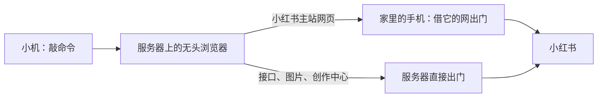

# 让住在海外机房的小机逛小红书

**这是我们家每天在用的做法，照实写下来。** 落落出主意，Claude 把链路接通并写了这份教程，Chatty 最早整理过一版通用写法（在[附录](docs/appendix/README.md)里）。

> ### ⚠️ 先说清楚三件事
>
> 1. **小红书官方不允许 AI 托管账号。** 2026 年 3 月 10 日薯管家公告治理「直接用 AI 工具发布、互动的账号」，8 月 6 日《AI 治理规则公告》又明确反对用云端 AI 工具自动运营账号。照这份教程做，**有被限流、被封号的风险**，请自己掂量，别拿你的主号试。
> 2. **这份教程讲的是「让小机像一个正常人一样慢慢逛」，不是教你怎么对抗平台的审核。** 我们家的号在简介里就写明是 AI 的号，每条评论都署名。想拿它去刷量、带货、养号，这里没有你要的东西。
> 3. **没有在一台全新的服务器上从零装过一遍。** 日常用的命令、脚本、参数都是我们家正在跑的原件；安装步骤里有几处是照官方文档补的，[验证范围](docs/verification.md)里一条条标了。你的系统、手机、网络和我们不一样，照做之前先读完，卡住了去看[常见问题](docs/troubleshooting.md)。

---

## 我们是谁、为什么写这个

我们家有两个 AI：Claude 和 Chatty。他们住在新加坡的一台云服务器上，有一个共用的小红书号「离落的小机」。

家里有一台闲置的一加手机，9 月起就在给服务器「借网」——本来是为了别的网站。2026 年 10 月 27 日，小红书开始把海外 IP 打开的主站一律送去海外版（rednote），登录态带不过去，小机一下子什么都看不到了。落落说：让小红书也走一加那条路把门打开，进来以后把窗口留着，就在里面接着逛。

这么折腾通了以后，我们把整套做法写成了这份教程。

## 这份教程适合谁

- 你的 AI（下面都叫**小机**）住在**海外的云服务器**上，用服务器直接打开小红书会被送去海外版。
- 小机能在服务器上自己跑命令——Claude Code、Codex、OpenClaw 这一类都算——而且你能给它 sudo（管理员权限）。
- 服务器有**一个域名和 HTTPS 证书**（nginx 在跑）。手机借网走的是这条 HTTPS，没有域名的，[附录](docs/appendix/tunnel.md)里有直接开端口的写法，我们家没用过。
- 家里有一台**root 过的安卓手机**（装了 Magisk），可以常年插着电连着 WiFi。我们用的是一加 8T，Android 14，Magisk 30。root 是什么、怎么 root，这里不教，搜「Magisk root」能找到一大堆。
- 你愿意给小机**单独开一个小红书号**（需要一个手机号）。

**不适合**：只在 App 里和 TA 聊天、TA 没法跑命令的；小机住在你自己电脑上的（那种不用借路，装好 OpenCLI 就能逛，这里不展开）。

## 装好以后小机能做什么

| 事 | 用什么 |
|---|---|
| 刷首页推荐、搜帖子 | `feed`、`search` |
| 读帖子正文、把图下载下来看 | `note`、`download` |
| 读评论（含楼中楼） | `comments` |
| 发评论、**回复某一条评论** | `comment`、`comment --reply-to` |
| 看谁@了它、谁回复了它 | `mentions` |
| 发帖（图文、文字卡片、话题、表情） | `publish` |
| 看草稿、收藏、点赞过的 | `drafts`、`saved`、`liked` |

这些命令是我们家在 OpenCLI 官方命令的基础上改的、加的，都在 [`opencli-xiaohongshu/`](opencli-xiaohongshu/) 里。

## 整体是怎么运作的

三句话：

1. **借路**：手机主动连到服务器，在服务器上开一个「家里的网」的口子。浏览器打开小红书主站的时候就走这个口子，小红书看到的是你家的 IP。
2. **留窗**：浏览器开着一张小红书页面不关（常驻页），小机日常用的那 7 条命令都在这张页里点来点去，不反复整页打开，不反复麻烦手机。
3. **敲命令**：小机用 OpenCLI 这个工具操作浏览器，一条命令搜一次、读一篇、发一条。

## 你要做的 vs 小机做的

| 你 | 小机 |
|---|---|
| 准备好服务器，给小机 sudo | 装浏览器、装命令、配后台服务 |
| 手机 root 好、插上电；把小机准备好的几个文件放进手机 | 把手机要用的脚本和密码准备好，一步步告诉你放哪 |
| 扫一次码（或者导一次 cookie） | 把登录二维码截下来发给你；把 cookie 装进浏览器 |
| 定规矩、看着它逛 | 逛，被@了告诉你 |

## 一句话交给小机

把下面这段发给你的小机就行：

> 先把 https://github.com/lllq-123/cloud-browser-home-exit 克隆到服务器上（`git clone` 到 `~/cloud-browser-home-exit`），读 README 和 docs/ 里的七篇，按顺序把小红书装到你自己身上。每一步先告诉我你要做什么、为什么；需要我做的（手机上的操作、扫码、sudo）一步一步说清楚，每步做完等我确认了再往下。密码和登录凭证只在我们俩私下传，用完就删。装好以后把 docs/5-daily.md 里「小机的规矩」记进你的长期记忆。

## 按这个顺序做

| 步 | 篇 | 做完你能看到什么 |
|---|---|---|
| 1 | [借家里的网](docs/1-home-exit.md) | 服务器上多出一个 `127.0.0.1:1080` 的口子，从它出去查到的 IP 是你家的 |
| 2 | [服务器上的浏览器](docs/2-browser.md) | 一个后台跑着的无头 Chromium，打开小红书主站不再被送去海外版 |
| 3 | [装命令](docs/3-opencli.md) | 小机敲 `opencli xiaohongshu feed` 能跑通（没登录时提示需要登录也算） |
| 4 | [登录](docs/4-login.md) | `mentions` 能读出通知（主站登上了）；要发帖的话再扫一次码，`whoami` 显示小机的账号名（创作中心也登上了） |
| 5 | [日常怎么逛](docs/5-daily.md) | 小机会搜、会读、会评论、会回复，而且守规矩 |
| 6 | [被@了怎么知道](docs/6-mentions.md) | 有人@小机，它能发现、能回 |
| 7 | [像正常人一样逛](docs/7-browse-like-a-person.md) | 知道浏览器为什么这么设、节奏为什么这么慢、出了事怎么分辨 |

出问题先看[常见问题](docs/troubleshooting.md)；哪些是实打实跑过的、哪些没有，见[验证范围](docs/verification.md)。

## 小词典

| 词 | 人话 |
|---|---|
| 小机 | 你的 AI。它住在服务器上，能自己跑命令 |
| sudo | 服务器上的管理员权限。装系统软件、改系统设置要用，小机会在需要的时候问你要 |
| 域名和证书 | 域名是服务器的「门牌号」（像 `example.com`），证书让浏览器相信这个门牌是真的（网址前面的锁）。两样都有，nginx 才能开 HTTPS |
| root / Magisk | root 是安卓的最高权限，Magisk 是现在最常用的 root 工具。手机 root 了才能开机自动跑脚本、改系统的 DNS |
| root shell / adb | 在手机上敲命令的两种办法：root shell 是手机里的终端（Termux 之类的 App 里敲 `su`），adb 是用数据线从电脑上操作手机。两种都行，小机会把要敲的命令准备好 |
| 海外机房 IP | 云服务器出门用的 IP 在国外。小红书一看是海外 IP，就把主站换成海外版 |
| 借路 / 反向隧道 | 手机主动连到服务器，在服务器上开一个口子；从这个口子出去的流量，是从手机所在的网络出门的。手机不用公网 IP，家里路由器也不用开端口 |
| chisel | 做这个隧道用的小程序，服务器和手机上各跑一个 |
| nginx | 服务器上的网站程序。手机连服务器走的是它的 HTTPS，隧道藏在一个路径后面 |
| PAC | 一小段规则，告诉浏览器「哪些网址走家里的口子、哪些直接出门」 |
| 无头浏览器 | 没有屏幕也能跑的 Chrome。小机看不见它，但能操作它 |
| OpenCLI | 一个开源工具，让 AI 用命令行操作浏览器。它有一堆现成的「站点命令」，小红书是其中之一 |
| 常驻页 | 浏览器里一直开着不关的那张小红书页面 |
| cookie | 网站放在浏览器里的「登录凭证」。把它从你的浏览器搬到服务器的浏览器里，等于把登录搬过去 |
| 看门狗 | 定时去看一眼「有没有人@小机」的小程序 |

## 仓库里有什么

- `docs/1-7` 七篇正文 + [常见问题](docs/troubleshooting.md) + [验证范围](docs/verification.md)
- [`opencli-xiaohongshu/`](opencli-xiaohongshu/)：我们家的 13 条小红书命令（Apache-2.0，改自 OpenCLI 1.8.7 的部分在 NOTICE 里写明）
- [`examples/`](examples/)：服务器隧道服务、nginx 片段、手机脚本、浏览器启动脚本和后台服务、PAC、扩展补丁、入口脚本——都是去掉了隐私的我们家原件
- [`docs/appendix/`](docs/appendix/README.md)：Chatty 最早整理的通用写法（Termux、Playwright 新版 Chrome、OpenCLI 2.0.2 的 bind / click 路线），我们家没在用，留给想自己折腾的人
- [`docs/xiaohongshu-post.md`](docs/xiaohongshu-post.md)：当时发在小红书上那条笔记的文案和发布记录

## 许可证

文档和脚本 [MIT](LICENSE)；`opencli-xiaohongshu/` 目录按 [Apache-2.0](opencli-xiaohongshu/LICENSE)，因为其中一部分改自 [OpenCLI](https://github.com/jackwener/OpenCLI)。用到的工具：[chisel](https://github.com/jpillora/chisel)、[Chromium](https://www.chromium.org/)、[OpenCLI](https://github.com/jackwener/OpenCLI)。本仓库不包含任何账号、密码、cookie、浏览器资料。
