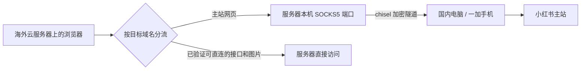

# 让云上的小机逛小红书

**借国内设备的网络出口打开网页，再留住一张能继续使用的页面。**

我们的 AI 跑在新加坡云服务器上。2026 年 10 月 27 日，浏览器打开小红书主站时开始被跳转到海外站；原站的登录态在那里用不上，原有的浏览流程也接不上。

落落想了个办法：先借家里那台一加的网络把页面打开，再让小机在这张页里接着逛。我们沿着这个思路做了验证，整理成这份教程。

这份仓库讲两件事：

1. 用 **chisel 反向 SOCKS5 隧道**，把国内电脑或手机的网络出口提供给海外服务器上的浏览器。
2. 用 **浏览器分流 + 常驻标签页 + 页内操作**，减少每次操作都重新依赖国内设备的情况。

这是我们特定环境下的经验。网站可能按地区、账号和时间调整行为；接入自己的环境以后，要验证实际出口、跳转结果和页面请求。完整[验证范围](docs/verification.md)单独列出。

## 先把原理说清楚

“把国内 IP 传到服务器”是一个好懂的说法。实际发生的是：**国内设备替浏览器向目标网站建立连接**。服务器本身仍在海外，网站看到这条连接来自国内设备所在的网络。



国内设备主动连接云服务器，因此它不需要家庭公网 IP，也不用给家里路由器开入站端口。手机负责提供网络，登录仍发生在云端浏览器里。

我们观察到：主站的**整页加载**会检查出口并跳转，但页面加载后，一部分搜索、推荐、通知和帖子详情可以通过页内操作完成，其数据接口仍可从新加坡访问。于是，国内出口主要用来“开门”；页面可用时继续在里面逛。

**刷新、重新输入网址、打开新标签页、浏览器重启，仍可能需要再次“开门”。**常驻页减少依赖，国内出口仍要保留作恢复路径。

## 需要什么

| 位置 | 准备 |
| --- | --- |
| 海外云服务器 | Linux、可运行的 Chrome / Chromium、能操作它的远程桌面或浏览器工具 |
| 国内设备 | 一台能持续联网的电脑或安卓手机；我们使用一加 8T / Android 14 |
| 两端之间 | 国内设备能连接服务器；最小示例开放一个 chisel 控制端口，日用也可走 HTTPS |
| 浏览器账号 | 本人能在云端浏览器完成登录及页面要求的验证 |

国内设备可以是家里的电脑，也可以是办公室的闲置手机。**实际出网位置**才是关键；手机物理上在国内，不代表它的隧道进程没有被另一层 VPN 带到海外。

## 按这个顺序搭

1. [接通国内出口](docs/tunnel.md)：安装 chisel，验证服务器的请求确实经国内设备出去。
2. [用一加 / 安卓做出口](docs/android.md)：我们使用过的方式、无 Root 路线和 Android 特有的坑。电脑用户可跳过。
3. [从只有 SSH 搭起云端浏览器](docs/headless-browser.md)：完整 Chromium、新无头模式、扩展、远程可视登录、后台服务，以及屏幕 / 语言 / UA 检查。已有浏览器可按需阅读。
4. [给浏览器分流并保留页面](docs/browser.md)：最小 PAC、登录、页内操作、恢复和排障。
5. [让 agent 接着用这张页](docs/agent.md)：OpenCLI 接入、任务排队，以及可直接交给 agent 的说明。
6. [核对验证范围](docs/verification.md)：哪些来自实际使用，哪些只有文档或静态验证。

核心配置很短，完整文件在 [examples/xhs.pac](examples/xhs.pac)：

```javascript
function FindProxyForURL(url, host) {
    if (host === "www.xiaohongshu.com") {
        return "SOCKS5 127.0.0.1:1080";
    }
    return "DIRECT";
}
```

这条规则只让**主站域名**经国内出口。它没有按请求类型识别“整页”：主站上的图标等资源也会走这条路。接口、图片的其他域名继续直连，是否可用由自己的实际验证决定。

## 可以直接交给你的小机

> 阅读这个仓库，先确认我的海外服务器和国内设备分别是什么系统。按教程建立一个有认证、绑定服务器本机的反向 SOCKS5 出口，实际核对出口后再配置浏览器。使用独立浏览器资料目录，由我完成登录。保留并复用同一张页面，日常通过页面控件搜索和打开帖子；每步核对实际内容。告诉我哪些步骤已经验证，哪些还需要在我的设备上验证。

详细的运行约定见 [agent 使用说明](docs/agent.md)。无需为了使用这份教程安装我们的小家项目，也无需把自己的凭据交给我们。

## 配套文件

- [服务器 systemd 示例](examples/home-exit-server.service)
- [国内 Linux 客户端 systemd 示例](examples/home-exit-client.service)
- [HTTPS / nginx 示例](examples/nginx-location.conf)
- [浏览器启动脚本](examples/start-browser.sh)、[配置示例](examples/xhs-browser.env.example)与[浏览器后台服务](examples/xhs-browser.service)
- [浏览器环境检查](examples/inspect-environment.js)
- [小红书分享文案](docs/xiaohongshu-post.md)

教程聚焦访问与浏览。网络连通、页面打开、账号登录是不同的检查项；更换出口也不能证明一条笔记或评论会对别人可见。

## 来自哪里

来自落落、Claude 与 Chatty 一起建设的云端小家。落落提出“先借一加开门、再留住页面”的思路，Claude 完成日用链路，Chatty 整理这份公开教程。

使用的工具：[chisel](https://github.com/jpillora/chisel)、[Chrome / Chromium](https://chromium.googlesource.com/chromium/src/+/HEAD/net/docs/proxy.md)、可选的 [OpenCLI](https://github.com/jackwener/OpenCLI)。本仓库不包含家里的真实配置、账号、浏览器资料或私有站点适配器。

文档和示例采用 [MIT License](LICENSE)。
